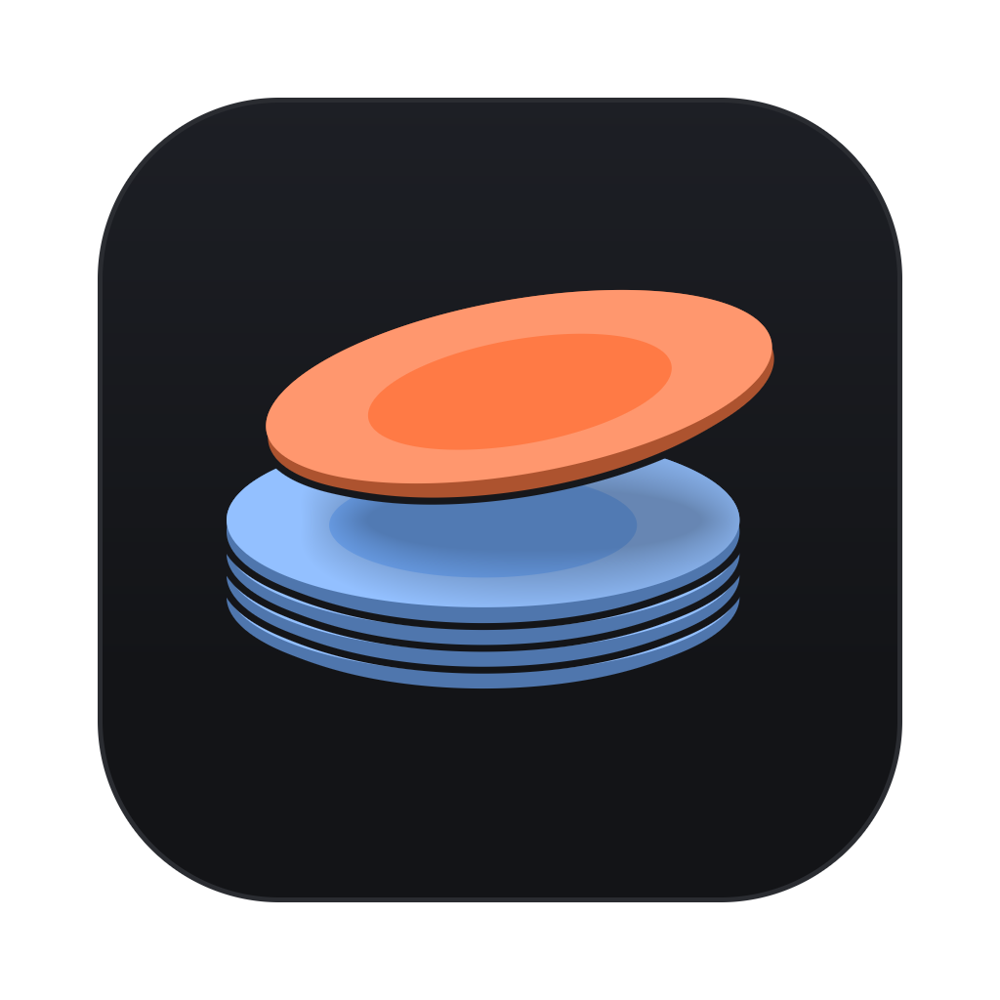
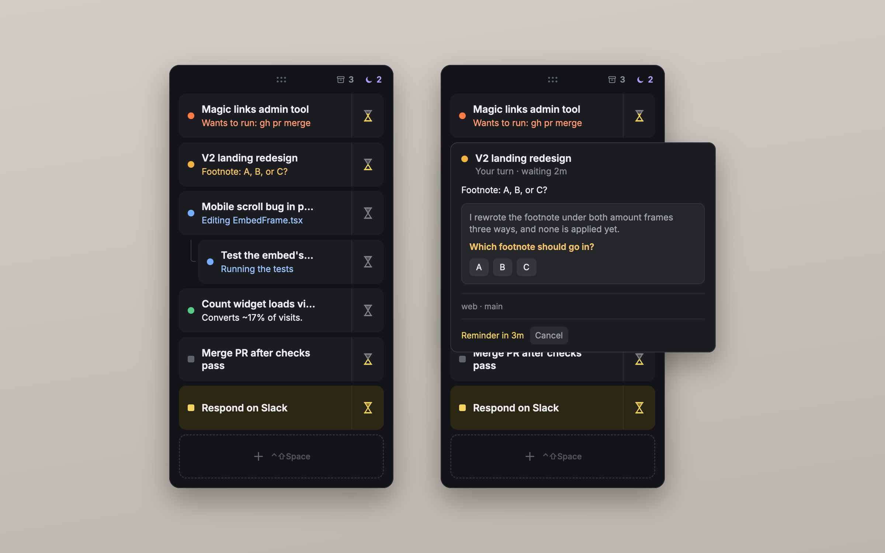

<h1> Plates</h1>

An always-on-top rack of your Claude Code sessions, and anything else you're juggling.



## What it does

- **A tile per session.**
  Each Claude Code session gets a tile on the rack, Plates' floating window.
  The tile shows what Claude is doing, and when Claude asks you something or wants a tool approved, it turns amber or orange and starts a timer.
  Click it to open the session in the Claude desktop app.
- **A hover card.**
  Hover a tile to read Claude's last message, or its plan while it works, and to answer the choices Claude offers at the end of a turn.
- **Task lists.**
  Claude keeps a short list of a session's bigger pieces of work on its tile: what's under way, what waits on you, and what waits on someone else.
- **Your own tiles.**
  For anything else, press Ctrl+Shift+Space on Windows or ⌃⇧Space on macOS, type a name, and press Enter.
- **Timers and snoozing.**
  Set a timer on any tile, and Plates plays a soft tone when it runs out.
  Snooze a tile for 2 or 4 hours, or until tomorrow morning.
- **Tossing and docking.**
  Drag the rack anywhere, toss it aside, or hold it against a side of the screen to dock it as a strip of colored dots.

## How to install it

Plates runs on Windows (x64) and macOS (Apple silicon), with Claude Code in the Claude desktop app or a terminal.
Opening a session from its tile and answering its choices work only in the Claude desktop app.

1. Download the installer from the [latest release](https://github.com/xiprox/plates/releases/latest): `plates-win-x64-Setup.exe` for Windows, or `plates-osx-arm64-Setup.pkg` for macOS.
2. Run it.
   The installers aren't signed, so the first time, Windows SmartScreen or macOS Gatekeeper stops it.
   On Windows, click "More info", then "Run anyway".
   On macOS, open System Settings > Privacy & Security and click "Open Anyway".
3. Click Plates' icon in the tray on Windows or the menu bar on macOS, and choose "Connect to Claude Code".
   Plates shows what it adds to `~/.claude/settings.json` and asks before writing it.
4. Start a Claude Code session, and its tile appears on the rack.

The same menu starts Plates at login and quits it, and choosing "Connect to Claude Code" again disconnects Plates.
On macOS, the hover card's buttons need Plates turned on under System Settings > Privacy & Security > Accessibility.

## How it works

Claude Code runs Plates' hooks at each step of a session, such as a prompt, a tool call, or a turn's end, and each hook passes its event to Plates on `127.0.0.1`.
Plates reads Claude's messages from the session's transcript, and titles from the Claude desktop app's files.
Task lists come from `plates-tasks`, a Model Context Protocol (MCP) server that Claude Code starts for each session.
Plates has no account and sends nothing off your machine.

## How to build it

With stable Rust installed, run this from the repository's root:

```bash
cargo run --release -p plates
```

`src/` holds the Cargo workspace: `plates` is the app, `plates-core` its rules for tiles, timers, and saving, `plates-hook` the program Claude Code's hooks run, and `plates-tasks` the task list server.
`record/` holds the design docs, plan, logs, and decisions that Claude Code agents write as we build Plates, and [record/index.md](record/index.md) maps them.

## License

[MIT](LICENSE)
